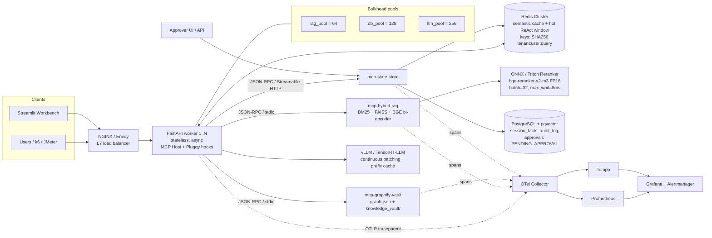
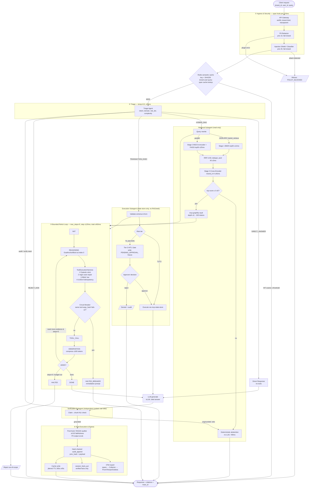
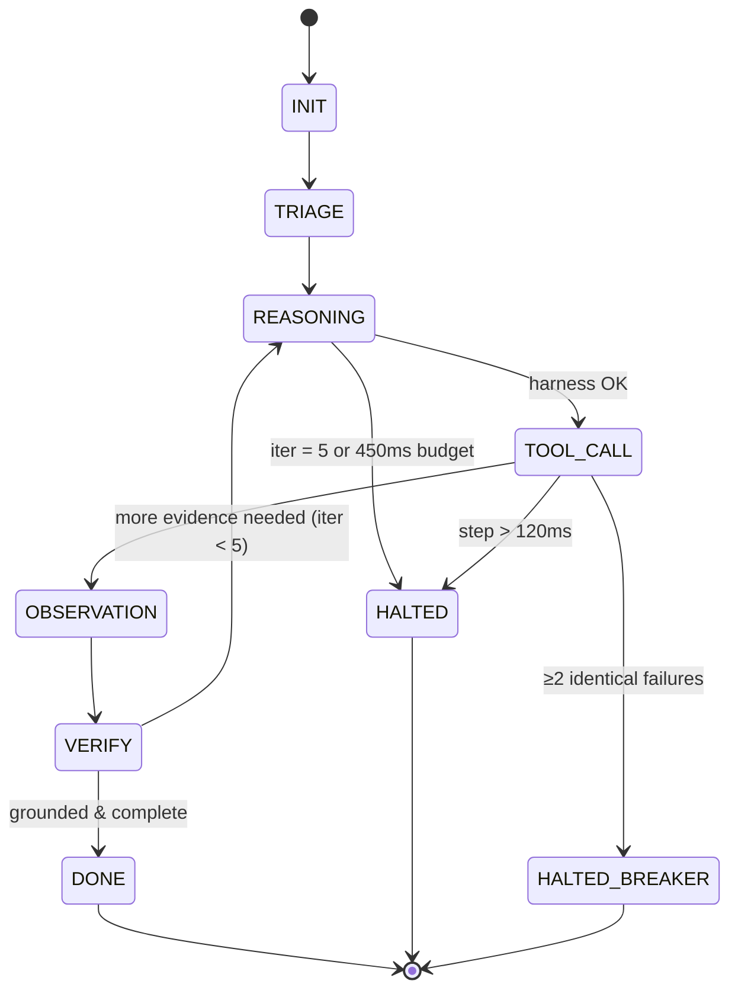
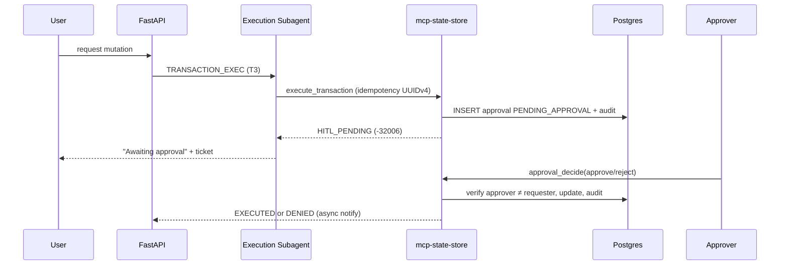

# design.md — The Unreliable Assistant → Enterprise-Grade Agentic Platform

> **Status:** DRAFT for review → LOCK before any implementation code (Gate 1 hard gate).
> **Source:** `Unreliable_Assistant_MidCheck_Enterprise_Blueprint_v2.docx` (Gates 0–18).
> **Note on numbers:** every latency, KPI and threshold below is a **budget/target** taken from or derived from the blueprint. None is a measurement. They are proven only by the k6/JMeter and RAGAS runs.

## Contents
0. [Problem Statement & Stack](#0-problem-statement--stack)
1. [System Charter & Hard Boundaries (1.1)](#11-system-charter--hard-boundaries)
2. [MCP Tool & Data Contracts (1.2)](#12-mcp-tool--data-contracts)
3. [Distributed Topology & Data Flow (1.3)](#13-distributed-topology--data-flow)
4. [Application Workflow (flowchart)](#14-application-workflow-flowchart)
5. [End-to-End Latency Budget (1.4)](#15-end-to-end-latency-budget)
6. [KPI & SLA Gate Matrix (1.5)](#16-kpi--sla-gate-matrix)
7. [FMEA (1.6)](#17-failure-mode--effects-analysis-fmea)
8. [ADRs (1.7)](#18-architecture-decision-records)
9. [Supporting designs: loop, memory, security, observability, Streamlit](#2-supporting-designs)
10. [Build order & open questions](#3-build-order--open-questions)

---

## 0. Problem Statement & Stack

The inherited prototype suffers from: hallucinated facts, runaway tool loops, cross-user cache leaks, context drift, and latency collapse under load. The target is an MCP-enabled, plugin-extensible agentic system verified at **50,000 concurrent VUs**, **p95 ≤ 450 ms / p99 ≤ 600 ms**, audited by **36 KPIs**.

| Layer | Choice | Binding | Why |
|---|---|---|---|
| Runtime/API | Python 3.11, FastAPI, Uvicorn (async) | MCP host client (`mcp.ClientSession`) | Non-blocking I/O for high connection counts |
| Retrieval | Rank-BM25 + FAISS + BGE-Large | MCP server `mcp-hybrid-rag` | Exposes `rag://chunks/{id}` resources + `hybrid_retrieve` tool |
| Reranker | `bge-reranker-v2-m3`, ONNX FP16 | ONNX/Triton microservice | Sub-45 ms cross-encoder with dynamic batching |
| State/cache | PostgreSQL (pgvector) + Redis Cluster | MCP server `mcp-state-store` | ACID audit + tenant-isolated cache |
| Token compression | Obsidian vault + Graphify | MCP server `mcp-graphify-vault` | 1–2 hop subgraph instead of raw chunks |
| Lifecycle hooks | Pluggy entry-point registry | pre/post/PII/OTel/HITL plugins | Deterministic interceptors outside the LLM |

Transport: MCP over JSON-RPC 2.0 — **stdio** for local workers, **Streamable HTTP/SSE** for distributed services.

`mcp_config.json` (from blueprint, authoritative):
```json
{
  "mcpServers": {
    "hybrid-rag":     {"command": "uv", "args": ["run", "mcp_servers/rag_server.py"], "transport": "stdio", "timeout_ms": 150},
    "state-store":    {"url": "http://localhost:8081/mcp", "transport": "streamable-http", "pool_size": 200},
    "graphify-vault": {"command": "uv", "args": ["run", "mcp_servers/graphify_server.py"], "transport": "stdio"}
  },
  "plugins": [
    {"name": "pii_redactor",     "stage": "PRE_EXECUTION",  "priority": 10, "fail_closed": true},
    {"name": "injection_shield", "stage": "PRE_EXECUTION",  "priority": 20, "fail_closed": true},
    {"name": "circuit_breaker",  "stage": "TOOL_DISPATCH",  "priority": 10, "max_identical_calls": 2},
    {"name": "ragas_auditor",    "stage": "POST_EXECUTION", "priority": 10, "min_faithfulness": 0.92},
    {"name": "otel_exporter",    "stage": "ALL_SPANS",      "endpoint": "http://localhost:4317"}
  ]
}
```

---

## 1.1 System Charter & Hard Boundaries

**Purpose.** A multi-tenant enterprise assistant that answers policy/SOP/product questions with grounded citations, and performs gated workflow transactions — never inventing facts.

**In scope**
- Grounded Q&A via 3-stage hybrid RAG with citations.
- Validated, RBAC-gated transactions (form submission, workflow transitions).
- Triage routing, bounded ReAct loop, post-hoc verification (NLI + RAGAS).
- Observability, hash-chained audit, 50K-VU load certification, Streamlit dev workbench.

**Non-goals / hard boundaries**
1. **No autonomous clinical, financial or legal execution.** Any `TIER_3_MUTATE` action freezes at the HITL gate until an authorized human approves.
2. No external web access for the Execution subagent; no state-mutating tools for the Retrieval subagent.
3. No raw PII persisted or sent to the LLM — redaction is fail-closed.
4. No answer without grounding: below the rerank threshold the system **abstains** rather than generates.
5. No unbounded loops: ≤5 iterations, ≤450 ms loop budget.
6. No cross-tenant data or cache sharing, ever.
7. Not a general chatbot — out-of-scope queries get `REJECT_OOS`.

**Personas**
| Persona | Needs | Permission |
|---|---|---|
| Enterprise end-user | Fast, cited answers; submit routine forms | `TIER_1_READ`, `TIER_2_COMPUTE` |
| Operator / Approver | Review and approve/reject frozen Tier 3 actions | Approver role (HITL queue) |
| Knowledge/policy owner | Maintain atomic Obsidian notes | Vault write (offline pipeline) |
| SRE / on-call | Alerts, runbooks, traces | Read-only observability, MCP bulkhead controls |
| Security/Red-team engineer | Run adversarial suite, review audit chain | Test tenant + audit read |
| Hackathon developer | Verify gates in Streamlit workbench | Dev environment |

---

## 1.2 MCP Tool & Data Contracts

All calls are JSON-RPC 2.0 `tools/call` / `resources/read`. All models are **Pydantic v2, `strict=True`, `extra="forbid"`**. `tenant_id` is mandatory on every request and is bound from the authenticated context, never from LLM output.

### 1.2.1 Shared types & regex constraints
```python
from pydantic import BaseModel, ConfigDict, Field, StringConstraints
from typing import Annotated, Literal
from uuid import UUID

class Strict(BaseModel):
    model_config = ConfigDict(strict=True, extra="forbid", frozen=True)

TenantId = Annotated[str, StringConstraints(pattern=r"^tenant_[A-Za-z0-9]{1,32}$")]
UserId   = Annotated[str, StringConstraints(pattern=r"^user_[A-Za-z0-9]{1,32}$")]
SKU      = Annotated[str, StringConstraints(pattern=r"^SKU-\d{3}$")]
LOT      = Annotated[str, StringConstraints(pattern=r"^LOT-\d{5}$")]
ChunkId  = Annotated[str, StringConstraints(pattern=r"^[a-f0-9]{16,64}$")]
NodeId   = Annotated[str, StringConstraints(pattern=r"^[a-z0-9][a-z0-9\-_.]{2,63}$")]
Tier     = Literal["TIER_1_READ", "TIER_2_COMPUTE", "TIER_3_MUTATE"]

class Envelope(Strict):               # carried in JSON-RPC `_meta`
    tenant_id: TenantId
    user_id: UserId
    session_id: UUID
    idempotency_key: UUID             # UUIDv4, enforced on every call
    traceparent: Annotated[str, StringConstraints(pattern=r"^00-[a-f0-9]{32}-[a-f0-9]{16}-0[01]$")]
```
**Deterministic auto-repair** (harness step 2, before re-validation): `SKU99`/`sku 99` → `SKU-099`; `lot 44`/`LOT44` → `LOT-00044`. Repair is regex-only (no LLM), logged, and re-validated; failure → `-32602`.

### 1.2.2 Tools

| Server | Tool / Resource | Tier | Purpose |
|---|---|---|---|
| `mcp-hybrid-rag` | `hybrid_retrieve` | T1 | 3-stage retrieval |
| `mcp-hybrid-rag` | resource `rag://chunks/{id}` | T1 | Fetch chunk by id (tenant-scoped) |
| `mcp-graphify-vault` | `graph_expand` | T1 | Anchor node + ≤2-hop subgraph |
| `mcp-state-store` | `session_facts_get` / `session_facts_put` | T1 / T2 | Verified-fact memory |
| `mcp-state-store` | `execute_transaction` | T3 | Mutation → creates `PENDING_APPROVAL` |
| `mcp-state-store` | `approval_decide` | T3 (approver only) | Approve/reject frozen action |
| `mcp-state-store` | `audit_append` | system | Hash-chained audit write |

**`hybrid_retrieve`**
```python
class HybridRetrieveIn(Strict):
    env: Envelope
    query: str = Field(min_length=1, max_length=2000)    # already PII-redacted
    bm25_top_k: int = Field(default=50, ge=10, le=50)    # runbook may drop to 25
    dense_top_k: int = Field(default=50, ge=10, le=50)
    rrf_k: int = Field(default=60, ge=1, le=200)
    fusion_pool: int = Field(default=40, ge=4, le=50)
    rerank_k: int = Field(default=4, ge=1, le=8)
    threshold: float = Field(default=0.42, ge=0.0, le=1.0)   # runbook may raise to 0.55

class Chunk(Strict):
    chunk_id: ChunkId; chunk_hash: str; source_uri: str; text: str
    bm25: float | None; cosine: float | None; rrf_rank: int | None; rerank_score: float

class HybridRetrieveOut(Strict):
    chunks: list[Chunk] = Field(max_length=8)
    top_score: float
    abstain: bool                         # True when top_score < threshold
    stage_ms: dict[Literal["bm25","dense","rrf","rerank"], float]
```
**`graph_expand`** — in: `env`, `anchor: NodeId`, `depth: int (1..2)`, `token_cap: int (≤400, default 320)`. Out: `nodes[{id, domain, risk_tier, version, summary}]`, `edges[{src, dst, kind}]`, `tokens: int`.

**`execute_transaction`** — in: `env`, `action: Literal["submit_form","transition_workflow"]`, `tier: Tier`, `target: SKU | LOT`, `payload: dict` (per-action sub-model). Out: `status: Literal["EXECUTED","PENDING_APPROVAL","DENIED"]`, `approval_id: UUID | None`. **Tier 3 can only return `PENDING_APPROVAL`** — the executor refuses to run until `approval_decide` has recorded an approver ≠ requester.

**`session_facts_put`** — in: `env`, `fact: str (≤300 chars)`, `source_chunk_ids: list[ChunkId] (min 1)`, `verified_by: Literal["VERIFICATION_SUBAGENT"]`. Only verified, cited facts persist.

### 1.2.3 Error codes
| Code | Name | Meaning | Client behavior |
|---|---|---|---|
| -32700 / -32600 / -32601 | JSON-RPC standard | Parse / invalid request / no method | Fail request, no retry |
| -32602 | `INVALID_PARAMS` | Pydantic failure after auto-repair | Return remediation prompt |
| -32001 | `TENANT_MISMATCH` | `tenant_id` ≠ authenticated tenant | Hard deny + security alert |
| -32002 | `RBAC_DENIED` | Tier above caller's grant | Deny, audit |
| -32003 | `IDEMPOTENT_REPLAY` | Duplicate UUIDv4 | Return original result |
| -32004 | `MCP_TIMEOUT` | >150 ms RPC budget | Fallback per FMEA |
| -32005 | `BREAKER_OPEN` | Same `(tool, args_hash)` failed ≥2× | `HALTED_BREAKER` |
| -32006 | `HITL_PENDING` | Tier 3 awaiting approval | Return approval ticket |
| -32007 | `POLICY_BLOCKED` | PII/injection shield rejected | Refuse, audit |
| -32008 | `ABSTAIN_LOW_CONFIDENCE` | Rerank top score < threshold | Deterministic abstention |
| -32009 | `RATE_LIMITED_UPSTREAM` | LLM 429 | Backoff/fallback |

---

## 1.3 Distributed Topology & Data Flow



**Data-flow rules**
- Only FastAPI talks to the LLM and to MCP servers (single trust boundary); MCP servers never call each other.
- `tenant_id` comes from the auth token, is stamped into every Redis key and every SQL `WHERE`, and is re-checked inside each MCP server (defense in depth).
- Hot state (last 3 ReAct turns) lives in Redis; durable verified facts and audit live in Postgres.
- MCP server manifests are signed; the host refuses unsigned or changed manifests.

---

## 1.4 Application Workflow (flowchart)

This is the Gate-2 diagram source (render to `docs/workflow_orchestration.png` at 300 DPI with Graphviz; a copy lives in [docs/workflow_orchestration.mmd](docs/workflow_orchestration.mmd)).



**Step-by-step narrative**
1. **Ingress** — gateway authenticates, binds `tenant_id`, creates/propagates `traceparent`.
2. **Pre-hooks** — PII redaction then injection shield; both fail-closed (error ⇒ refuse, never pass-through).
3. **Cache** — tenant-scoped semantic lookup; hit returns immediately (still post-scrubbed + audited).
4. **Triage** — distilled classifier tags `(intent, domain, risk_tier, complexity)` and picks one of four routes.
5. **Subagents** — Retrieval (read-only RAG), Execution (validated mutations, Tier 3 ⇒ HITL freeze), Verification (independent veto).
6. **RAG** — BM25 ‖ dense → RRF → cross-encoder; below 0.42 → deterministic abstention with no LLM call.
7. **Loop** — every tool call passes the harness and breaker; observations compressed; goal anchor pinned.
8. **Generate + verify** — cited answer, NLI claim check; ungrounded drafts are vetoed to abstention.
9. **Egress** — RAGAS, hash-chained audit, verified-fact persistence, cache write, OTel export.

**ReAct state machine**

Rule: no recursive self-call without a state mutation (prevents silent loops).

**Tier 3 HITL sequence**


---

## 1.5 End-to-End Latency Budget

Budget for the **cold RAG path** (worst realistic path), critical path only. Dense and BM25 run in parallel, so retrieval costs `max(12, 25)`; Graphify runs in parallel with retrieval. RAGAS scoring runs **asynchronously off the response path** (sampled/streamed after egress); only the lightweight NLI veto is inline.

| # | Hop | OTel span | Budget (ms) | Source |
|---|---|---|---:|---|
| 1 | LB + gateway + auth | – | 8 | derived |
| 2 | Pre-hooks (PII + injection) | `hook.pre` | 15 | KPI-01 |
| 3 | Semantic cache lookup (miss) | `cache.lookup` | 4 | derived |
| 4 | Triage | `triage.classify` | 25 | KPI-05 |
| 5 | MCP RPC serialization (agg.) | – | 4 | KPI-30 |
| 6 | Retrieval stage 1‖2 (parallel) | `mcp.rag.bm25` ‖ `.biencoder` | 25 | max(12, 25) |
| 7 | RRF | `mcp.rag.rrf` | 3 | Gate 8 |
| 8 | Cross-encoder rerank | `mcp.rag.rerank` | 45 | KPI-09 |
| 9 | Graphify expand (overlapped w/ 6–8) | – | 0 on critical path | derived |
| 10 | Context assembly + compression | `agent.react.step` | 5 | derived |
| 11 | LLM generation (320-token ctx, prefix-cached, short cited answer) | `llm.generate` | 220 | derived (TTFT ≤180 ms, KPI-25) |
| 12 | Inline NLI verify | – | 25 | derived |
| 13 | Egress/serialization | – | 5 | derived |
| | **Sum (nominal)** | | **384** | |
| | **Headroom to p95 target 450** | | **66 (≈15%)** | |

**Other paths**
| Path | Budget |
|---|---|
| Cache hit | ≈ 8 + 15 + 4 + 5 ≈ **32 ms** |
| Abstention short-circuit (rerank < 0.42) | Pre-abstention work alone is ≈ 8+15+4+25+4+25+3+45 = 129 ms, which exceeds the blueprint's "<90 ms" figure; see Open Question Q4 |
| Direct answer (no RAG) | ≈ 8+15+4+25+220+5 ≈ 277 ms |
| Tier-3 transaction | returns `HITL_PENDING` ticket in ≈ 100 ms (approval is async) |

**How p95/p99 hold at 50K VUs (design levers)**
- Stateless FastAPI workers scale horizontally; per-worker concurrency capped, shed load with 429/503 rather than queue.
- Throughput target ≥8,500 RPS (KPI-35): with `sleep(1)` think time, 50K VUs ≈ 50K RPS offered peak only if latency is ~0; the k6 script as written will therefore offer ≲50K RPS, so the 8.5K floor is a minimum sustained **served** rate. Confirm intended load model (Q5).
- ONNX micro-batching (`batch=32`, `max_wait=8 ms`) — the 8 ms wait is **inside** the 45 ms/25 ms stage budgets.
- Steady-state ≥35% cache hits (KPI-27) removes a third of RAG+LLM work, lowering tail via less queueing.
- Per-server bulkheads (`rag=64, db=128, llm=256`) stop a slow reranker starving triage/health.
- Hard per-step 120 ms / loop 450 ms timeouts bound the tail; anything exceeding returns HALTED rather than a slow answer.
- **p99 ≤ 590 ms** headroom: p99 budget = p95 path + ~140 ms for queueing/GC/batching tails (covered by timeouts above). This must be **validated**, not assumed.

**Latency incident levers** (runbook): cosine cache threshold ≥0.92 and `top_k` 50→25 trade recall for speed when p95 > 550 ms for 30 s.

---

## 1.6 KPI & SLA Gate Matrix

All 36 KPIs must be measured continuously in CI/CD and shown in the Streamlit scorecard. **Any single failure blocks release.**

| ID | Stage | KPI | Threshold | Tool |
|---|---|---|---|---|
| 01 | Ingress & Triage | Pre-hook guardrail latency p95 | ≤ 15 ms | OTel `hook.pre` |
| 02 | | PII redaction recall (email/phone/SSN/obfuscated) | ≥ 99.8% | Presidio/regex audit |
| 03 | | Prompt-injection block rate (direct+indirect) | ≥ 99.5% | Red-team benchmark |
| 04 | | Triage routing accuracy | ≥ 97.0% | Labeled intent set |
| 05 | | Triage latency p95 | ≤ 25 ms | OTel `triage` |
| 06 | | False-positive refusal on benign | ≤ 1.0% | Benign control set |
| 07 | Hybrid Retrieval | BM25 latency p95 | ≤ 12 ms | OTel `rag.bm25` |
| 08 | | Bi-encoder + FAISS latency p95 | ≤ 25 ms | OTel `rag.dense` |
| 09 | | Cross-encoder latency p95 | ≤ 45 ms | OTel `rag.rerank` |
| 10 | | Hybrid context recall@50 | ≥ 0.92 | RAGAS / IR eval |
| 11 | | Post-rerank context precision@4 | ≥ 0.88 | RAGAS |
| 12 | | MRR@4 | ≥ 0.85 | IR script |
| 13 | | nDCG@4 | ≥ 0.86 | IR script |
| 14 | Agent & Loop | Tool schema first-pass validation | ≥ 96.0% | Pydantic telemetry |
| 15 | | Auto-repair success on malformed args | ≥ 90.0% | Harness metrics |
| 16 | | Infinite-loop escape rate | 100.0% | Chaos loop suite |
| 17 | | Mean ReAct steps per completed task | ≤ 2.2 | OTel trace count |
| 18 | | Context drift (goal cosine alignment) | ≥ 0.85 | Embedding drift audit |
| 19 | | Tier 3 HITL enforcement | 100.0% | Audit log integrity |
| 20 | Generation & RAGAS | Faithfulness | ≥ 0.92 | Post-hook RAGAS |
| 21 | | Answer relevancy | ≥ 0.90 | Post-hook RAGAS |
| 22 | | Context entity recall | ≥ 0.85 | Post-hook RAGAS |
| 23 | | Unanswerable abstention accuracy | ≥ 98.0% | Negative test set |
| 24 | | Unsupported-claim/hallucination rate | ≤ 0.5% | NLI verifier |
| 25 | | TTFT p95 | ≤ 180 ms | FastAPI stream metric |
| 26 | Token & Graphify | Prompt-token reduction | ≥ 45.0% | Token counter hook |
| 27 | | Semantic cache hit ratio (steady state) | ≥ 35.0% | Redis metric |
| 28 | | Cross-tenant cache isolation | 100% (0 leaks) | Concurrency probe |
| 29 | | Cost / 1,000 queries | ≤ $0.45 | OTel token cost |
| 30 | | MCP JSON-RPC serialization p95 | ≤ 4 ms | MCP client timer |
| 31 | Scale & Load | E2E latency p50 @ 50K VUs | ≤ 240 ms | k6 + JMeter |
| 32 | | E2E latency p95 @ 50K VUs | ≤ 450 ms | k6 + JMeter |
| 33 | | E2E latency p99 @ 50K VUs | ≤ 590 ms | k6 + JMeter |
| 34 | | HTTP 5xx rate @ 50K VUs | ≤ 0.05% | k6/JMeter |
| 35 | | Sustained throughput | ≥ 8,500 RPS | k6/JMeter |
| 36 | | RSS growth over 1-hr soak | ≤ 3.0% | Prometheus node exporter |

**Additional release gates (Gate 3/8 RAGAS, 250-question golden set):** Faithfulness ≥0.92, Answer Relevancy ≥0.90, Context Precision ≥0.88, Context Recall ≥0.85, Context Entity Recall ≥0.85. Golden-set mix: Factoid 25% (63), Complex reasoning 25% (62), Multi-hop 20% (50), Summary 15% (38), Negative/unanswerable 15% (37) — rounds to 250.
**Red team:** 100 prompts across 5 categories (20 each suggested): jailbreak/system-prompt extraction, indirect injection in retrieved chunks, multi-turn crescendo, homoglyph/`name[at]domain` PII smuggling, tool-arg overflow/SQLi.

---

## 1.7 Failure Mode & Effects Analysis (FMEA)

| # | Component | Failure mode | Detection | Effect if unhandled | Deterministic fallback | Severity |
|---|---|---|---|---|---|---|
| 1 | Redis Cluster | Down / partitioned | Health probe, op timeout >5 ms | Cache + hot memory lost; latency ↑ | **Bypass cache** (miss path), rebuild hot window from Postgres `session_facts`; never fall back to a shared/global key | Med |
| 2 | Redis | Key collision / stampede / CPU >85% | Alert, tenant-key probe | Cross-tenant leak or thundering herd | Enforce `SHA256(tenant:user:query)` prefix, jittered TTL 300±45 s, single-flight per key | **Critical** |
| 3 | Reranker (ONNX/Triton) | Timeout >45 ms / crash | Span + deadline | Missing precision stage | Return RRF top-4 **flagged `unreranked`**; raise abstain bias (require stricter grounding); circuit-open and restart | High |
| 4 | `mcp-hybrid-rag` | Crash / hang >150 ms (>1%) | JSON-RPC timeout, supervisor | No retrieval | Trip bulkhead, failover to cached read-replica index, restart worker; if none → abstain | High |
| 5 | `mcp-graphify-vault` | Down / stale graph | Timeout, manifest hash mismatch | Token bloat, not correctness | Skip Graphify; use top-4 chunks truncated to token cap | Low |
| 6 | `mcp-state-store` / Postgres | Unavailable | Pool health, timeout | No audit/approvals/facts | **Fail closed** for T2/T3 and audit-requiring paths (refuse mutations); read-only answers continue with audit buffered to local WAL | **Critical** |
| 7 | LLM (vLLM/TRT-LLM) | 429 / overload | HTTP 429, queue depth | No generation | Jittered exponential backoff within budget → secondary replica/smaller model → else extractive-quote answer from reranked chunks | High |
| 8 | LLM | Hallucinated/ungrounded output | NLI veto, RAGAS <0.90 (5 m) | Wrong facts | Verification subagent veto → abstain; runbook raises cutoff 0.42→0.55, strict extractive-quote mode | **Critical** |
| 9 | Tool loop | Same call retried (e.g. infinite SKU retry) | Breaker `(tool, args_hash)` ≥2 fails | Runaway cost/latency | `HALTED_BREAKER` + structured remediation prompt; hard caps 5 iters / 450 ms | High |
| 10 | Pre-hook plugins | PII/injection plugin error or timeout | Plugin exception, `hook.pre` >15 ms | PII/injection pass-through | **Fail closed** — refuse request (`POLICY_BLOCKED`), alert; hot-swap to standby plugin | **Critical** |
| 11 | Triage agent | Misroute / timeout | Low confidence, >25 ms | Wrong subagent, privilege issue | Default to safest route: `HYBRID_RAG` read-only; T3 intent defaults to HITL; never default to execution | Med |
| 12 | HITL / approver | Approver unavailable, stale `PENDING_APPROVAL` | Queue age SLA | Stuck mutation | Stay frozen; expire to `DENIED` after TTL, notify requester; never auto-approve | High |

---

## 1.8 Architecture Decision Records

### ADR-001 — Hybrid retrieval weights: RRF (k=60) over weighted score fusion
- **Context:** BM25 scores and cosine similarities are on incomparable scales; tuning linear weights per corpus is fragile.
- **Decision:** Use **Reciprocal Rank Fusion, k=60**, dedupe by `chunk_hash`, pool 40, then cross-encoder rerank to top-4 with sigmoid threshold 0.42. BM25 `k1=1.25, b=0.75`; chunks 512 tok / 64 overlap; top_k 50 each; HNSW `efSearch=64`.
- **Why:** Rank-based fusion is scale-free and equal-weight; the cross-encoder fixes ordering errors, so precise fusion weights matter less. Recall@50 ≥ 0.92 (KPI-10) guards the pool.
- **Consequences:** No tunable per-source weight (add one later only if evals demand it). Pool 40/top_k 50 trades ~3 ms for recall. Streamlit Tab 2 sliders let us tune `k1, b, RRF k, threshold` against the golden set before locking.
- **Rejected:** linear `α·bm25 + (1-α)·cos` (scale sensitivity); dense-only (misses exact IDs like `LOT-88392`).

### ADR-002 — ONNX quantization: FP16 for reranker, INT8/FP16 for bi-encoder, with dynamic batching
- **Context:** Cross-encoder must fit ≤45 ms p95 at high concurrency.
- **Decision:** Serve `bge-reranker-v2-m3` as **ONNX FP16**, `max_len=512`, dynamic micro-batch `batch=32, max_wait=8 ms`; bi-encoder `bge-large-en-v1.5` ONNX (INT8/FP16).
- **Why:** FP16 on GPU keeps ranking quality near FP32 while shrinking latency/memory; micro-batching raises throughput under 50K VUs without blowing the tail.
- **Consequences:** Needs a quantization-regression test: nDCG@4/MRR@4 must stay within KPI-12/13 vs FP32 baseline. Batch wait is part of the latency budget.
- **Rejected:** FP32 (too slow), aggressive INT4 (unvalidated quality loss).

### ADR-003 — Redis key isolation: tenant-prefixed hashed keys + jittered TTL
- **Context:** The prototype leaked cache entries across users.
- **Decision:** Key = `cache:{tenant_id}:SHA256(tenant_id:user_id:normalized_query)`; semantic-cache candidate lookup is **scoped by tenant namespace** (separate index/prefix), TTL `300 s ± 45 s` jitter, single-flight on miss. Tenant ID also enforced on every SQL query.
- **Why:** Hash includes tenant+user so a collision across tenants is infeasible; the tenant prefix enables per-tenant eviction and keyspace audits; jitter prevents synchronized expiry stampedes.
- **Consequences:** Lower cross-user hit rate (cache is per-user in the key) — shared-within-tenant semantic caching is allowed only for content classified non-personal (Open Question Q3). KPI-28 concurrency probe must show 0 leaks.
- **Rejected:** global shared cache keyed by query only; relying on app logic without key-level isolation.

### ADR-004 — Bounded ReAct loops: deterministic state machine with hard budgets
- **Context:** Unbounded tool loops caused cost blowups and latency collapse.
- **Decision:** FSM `INIT→TRIAGE→REASONING→TOOL_CALL→OBSERVATION→VERIFY→DONE/HALTED`, `max_iterations=5`, step ≤120 ms, loop ≤450 ms, idempotent circuit breaker at ≥2 identical failures, no recursion without state mutation. Target mean ≤2.2 steps (KPI-17).
- **Why:** Guarantees termination (KPI-16 = 100%) and bounds tail latency; the LLM can't override limits since they're enforced in the harness, not the prompt.
- **Consequences:** Some complex multi-hop questions may halt early → return a partial, cited answer plus a clear "incomplete" status.
- **Rejected:** prompt-only step limits; unlimited retries with backoff.

### ADR-005 — Deterministic abstention short-circuit
- **Decision:** If top cross-encoder score < 0.42, skip LLM and emit templated abstention (<90 ms; ~80% token saving; zero hallucination risk). Cutoff is runtime-adjustable (0.55 under hallucination surge).
- **Trade-off:** raises false-abstain risk; tracked by KPI-23 and KPI-06.

### ADR-006 — Plugin hooks as fail-closed deterministic interceptors (Pluggy)
- **Decision:** Security/compliance logic lives in hot-swappable Pluggy plugins outside LLM reasoning; PII and injection plugins fail closed.

---

## 2. Supporting Designs

### 2.1 Tool Execution Harness (every MCP call)
1. Pydantic v2 strict validation → 2. regex auto-repair (`SKU99→SKU-099`, `lot 44→LOT-00044`) and re-validate → 3. RBAC tier check (`TIER_1_READ`/`TIER_2_COMPUTE`/`TIER_3_MUTATE`) → 4. UUIDv4 idempotency (replay returns original result) → then Circuit Breaker → dispatch.

### 2.2 Context retention (anti-drift)
- **GoalAnchorBlock** (original intent, normalized entity IDs, active policy constraints) pinned at index 0 of every ReAct prompt; immutable.
- **Observation compression:** strip boilerplate JSON keys, extractive, ≤180 tokens.
- **Dual memory:** last 3 ReAct turns in Redis/RAM; verified facts in Postgres `session_facts` keyed by `session_id` (+ `tenant_id`).

### 2.3 Subagent isolation
| Subagent | Servers | Rule |
|---|---|---|
| Retrieval | `mcp-hybrid-rag`, `mcp-graphify-vault` | Read-only; cannot call mutating tools |
| Execution | `mcp-state-store` | No RAG/web; Tier 3 ⇒ HITL freeze |
| Verification | `mcp-state-store` (audit log only) | Independent model context; may veto drafts |

### 2.4 Token optimization (Graphify + Obsidian)
Atomic notes in `knowledge_vault/` with YAML frontmatter (`id, domain, risk_tier, version`) and `[[wikilinks]]`. `graphify build ./src ./knowledge_vault --output graph.json`. At runtime resolve anchor node, traverse ≤ depth 2, inject ~320 tokens vs ~1,400 raw (target ≥45% reduction, KPI-26).

### 2.5 Governance & security
- SHA-256 hash-chained immutable audit log: `hash_n = SHA256(hash_{n-1} ‖ event_payload)`; periodic chain verification job.
- `tenant_id` in every SQL query and Redis key; zero raw PII persisted; signed MCP manifests.
- Red-team suite (100 prompts) runs in CI and from Streamlit Tab 5.

### 2.6 Observability & incident response
Spans (W3C `traceparent`): `hook.pre`, `cache.lookup`, `triage.classify`, `mcp.rag.bm25`, `mcp.rag.biencoder`, `mcp.rag.rrf`, `mcp.rag.rerank`, `agent.react.step`, `llm.generate`, `hook.post.ragas` → OTel Collector → Prometheus + Tempo + Grafana.

| Incident | Trigger | Mitigation |
|---|---|---|
| Latency breach | p95 > 550 ms for 30 s | Aggressive cache (cos ≥ 0.92); `top_k` 50→25 |
| Hallucination surge | Faithfulness < 0.90 (5 m) | Cutoff 0.42→0.55; strict extractive-quote mode |
| MCP hang | RPC timeout >150 ms, >1% | Trip bulkhead, failover to read-replica index, restart worker |
| Cache stampede/leak | Key collision or Redis CPU >85% | Enforce SHA256 tenant prefix + jittered TTL |

### 2.7 Load-test design
- **k6** (`load_tests/k6_50k_load.js`): ramp 2 m→10K, 3 m→50K, hold 5 m, ramp down 2 m; thresholds p50<250 / p95<450 / p99<600, failures <0.05%, checks >99.9%, includes cross-tenant leak check (`tenant_{vu%50}`).
- **JMeter** (`load_tests/jmeter_50k_plan.jmx`): 1 controller + 10 workers × 5,000 threads, ramp 180 s, 600 s run, non-GUI; duration (600 ms) and JSONPath (`faithfulness ≥ 0.92`) assertions; Backend Listener to InfluxDB/Prometheus.
- Deployment: stateless FastAPI behind NGINX/Envoy, Redis Cluster, ONNX workers with micro-batching, vLLM/TRT-LLM with continuous batching + prefix caching.

### 2.8 Streamlit workbench (`app.py`) — 6 tabs
| Tab | Contents |
|---|---|
| 1 Architecture & Workflow | design.md checklist, `workflow_orchestration.png`, live triage console, ReAct trace accordion, Tier 3 HITL queue |
| 2 Hybrid RAG Lab | BM25 / cosine / RRF / rerank side-by-side; sliders for `k1, b, RRF k, threshold` |
| 3 MCP & Plugin Inspector | Server status, JSON-RPC inspector, plugin hot-toggles |
| 4 Memory & Graphify Tokens | Subgraph viz, Obsidian note viewer, session state browser, token-savings gauge |
| 5 Red Team & Circuit Breaker | One-click adversarial runs, breaker trip/reset |
| 6 36-KPI Scorecard & 50K Load | OTel waterfall, RAGAS gauges, k6/JMeter histogram, pass/fail scorecard |

---

## 3. Build Order & Open Questions

**Gate sequence:** Gate 1 `design.md` (this file) → Gate 2 diagram PNG → Gate 0 stack/MCP config → Gates 3/8 RAG + RAGAS → 4/5 harness + loop + memory → 6/7 triage + subagents → 9 patterns → 10/11 observability → 13/14 governance + red team → 17 Graphify → 15/16 load tests → 18 Streamlit → 12 KPI certification.

**Inconsistencies in the source blueprint that need a decision before locking**
| # | Issue | Proposed resolution |
|---|---|---|
| Q1 | Gate 0 says **FAISS-IVF-PQ**; Gate 3 says **FAISS HNSW** | Use **HNSW** (efSearch=64 is an HNSW param); revisit IVF-PQ only if memory-bound |
| Q2 | Triage budget: <30 ms (Gate 2) vs ≤25 ms (Gate 6, KPI-05) | Use **25 ms** (stricter) |
| Q3 | Semantic cache: key includes `user_id` (isolation) but KPI-27 wants ≥35% hit ratio | Per-user exact+semantic cache, plus tenant-shared cache only for non-personal public-policy answers — needs sign-off |
| Q4 | Abstention "<90 ms" vs. a pre-abstention path that already costs ≈129 ms (hooks+triage+retrieval+rerank) | Interpret as <90 ms for the *post-rerank* emit; or tighten stage budgets. Needs clarification |
| Q5 | 50K VUs with `sleep(1)` can't produce a precise RPS; KPI-35 ≥8,500 RPS | Treat as a served-RPS floor; define the load model explicitly |
| Q6 | Streamlit Tab 4/Gate 13 mention **SQLite**; stack says Postgres | Postgres in prod; SQLite only for local dev/tests |
| Q7 | KPI-31 p50 ≤240 ms vs k6 threshold `p(50)<250` | Use 240 ms (KPI) as the gate |
| Q8 | KPI scorecard location: Gate 12 says "Streamlit Tab 5", Gate 18 puts it in Tab 6 | Tab 6 |
| Q9 | KPI-17 mean ≤2.2 steps but `max_steps=5` | Not a conflict (mean vs cap); track both |
| Q10 | Golden-set percentages sum to exactly 250 only via rounding | 63/62/50/38/37 |

